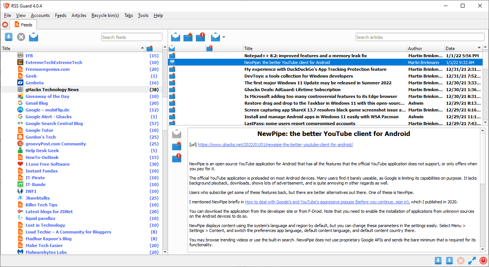
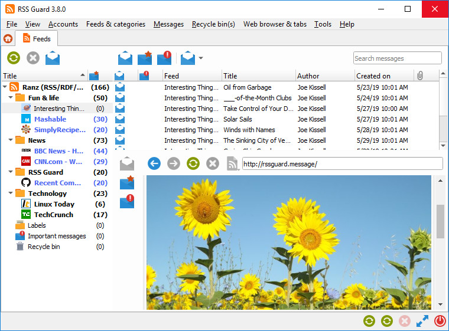
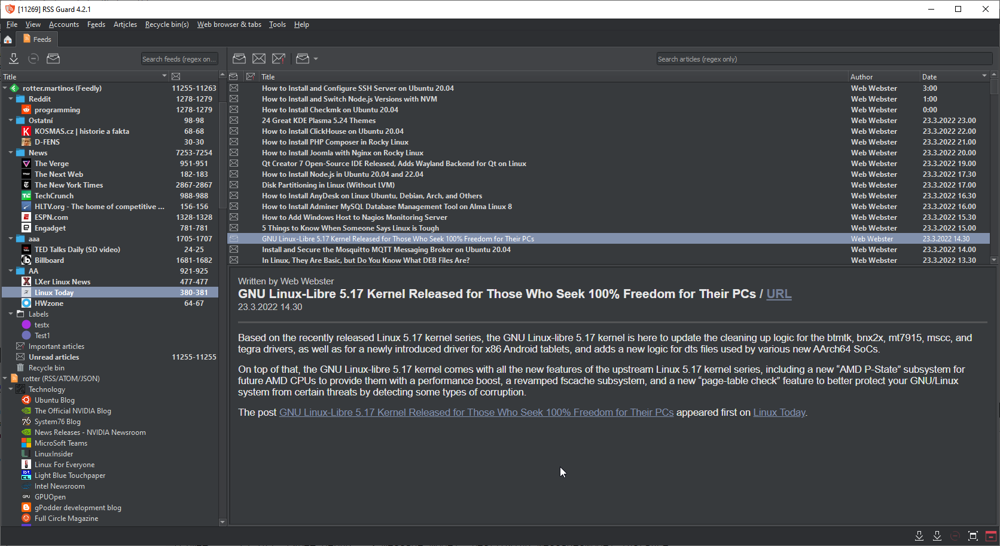

# RSS Guard: A Reading Desk Across Feed Services

Keep subscriptions, article decisions, and reading tools together without losing track of which account owns the data.
This RSS Guard Tutorial follows a small reading collection from subscription import to filtering, article display, and recovery.

[](https://rss-guard-tutorial.github.io/RSS-Guard/)

## Decide where the reading state belongs

A local subscription and a synchronized service account can show the same publisher while keeping separate reading histories.
Choose the account type before importing a large subscription list.

| Account choice | Subscription source | Reading-state responsibility |
| --- | --- | --- |
| Local RSS/RDF/ATOM/JSON | Feed URLs managed in RSS Guard | The local application database |
| A supported hosted service | Subscriptions associated with that service | The service and its supported synchronization API |
| A supported self-hosted service | Your server's account and endpoint | Your server and the selected RSS Guard integration |

RSS Guard supports services including Feedly, Nextcloud News, Tiny Tiny RSS, and Google Reader API-compatible servers.
Check the selected plugin's capabilities when you need particular state changes to travel between devices.
An account icon or a matching article title does not prove that two accounts share their state.

For an isolated trial, launch an installed application with a separate user-data folder:

```bash
rssguard --data "./rssguard-trial"
```

Use the executable name or full path appropriate to your installation.
The native `--data` option selects another profile and disables single-instance mode.
Keep each running instance on its own profile.
See the [command-line reference](https://rssguard.readthedocs.io/en/stable/features/cli.html) for the available options.



The supplied [test_feedvalidators.cpp](tests/standard/test_feedvalidators.cpp) exercises standard-feed request validators.
Icon selection and discovery behavior is covered in [test_feedicons.cpp](tests/standard/test_feedicons.cpp).
These are useful source references when investigating feed behavior rather than account synchronization.

## Move subscriptions without confusing them with history

OPML describes a subscription list and its outline structure.
Treat it as a way to transfer feeds, while retaining a separate backup for stored articles and application settings.

Here is a small original OPML 2.0 document for one public news feed:

```xml
<?xml version="1.0" encoding="UTF-8"?>
<opml version="2.0">
  <head><title>Reading trial</title></head>
  <body>
    <outline text="Arch Linux News" title="Arch Linux News"
      type="rss" xmlUrl="https://archlinux.org/feeds/news/"/>
  </body>
</opml>
```

Save it as `reading-trial.opml` and use the local account's import action.
Review the selected feeds and destination folder before fetching the imported subscriptions.
The [standard-feed guide](https://rssguard.readthedocs.io/en/stable/services/standard.html) describes account-level OPML import and export.

After a larger import, compare the folder arrangement and subscription count with the exported list.
A feed can have moved, stopped publishing, or changed its title since the previous reader last fetched it.
Check a few active feeds instead of assuming an empty first refresh means the import failed.

XML declaration handling is exercised in [test_xmlencodingdetector.cpp](tests/miscellaneous/test_xmlencodingdetector.cpp).
Parsing and malformed-document cases appear in [test_domdocument.cpp](tests/miscellaneous/test_domdocument.cpp).

## Build a reading queue you can finish

Organize feeds around the decisions you make while reading.
A small daily group and a separate occasional-reference group are often easier to review than one undifferentiated list.

Use folders for subscription organization and labels for article-level follow-up.
Give a label a concrete meaning such as material to investigate, cite, or discuss.
Keep read status separate from importance: finishing an article does not necessarily mean its usefulness has ended.

A practical review pass can follow this sequence:

1. Refresh the intended account or feed group.
2. Scan titles and dates for items relevant to the current task.
3. Open enough of an article to decide whether it needs attention.
4. Label or mark important items that require a later action.
5. Mark completed reading according to the policy you selected in preferences.

Check the active sort column and direction when an article seems to disappear from its expected position.
Also check whether a text filter or read-state view is hiding it.

The regression scenarios in [test_articlesorting.cpp](tests/gui/test_articlesorting.cpp) cover article-list sorting.
Label menu behavior is exercised in [test_labelsmenu.cpp](tests/gui/test_labelsmenu.cpp).
Text matching modes are covered separately in [test_filtermatchmode.cpp](tests/gui/test_filtermatchmode.cpp).

Change one organizational rule at a time.
If you cannot explain why an article is in the current view, simplify the filters before adding more labels.

## Test an article rule before relying on it

RSS Guard article filters use JavaScript and a `filterMessage()` entry point.
For newly arriving articles, this original example adds a visible prefix to matching titles while accepting every article:

```javascript
function filterMessage() {
  const title = String(msg.title);
  if (/release notes|security advisory/i.test(title) &&
      title.indexOf("[Review] ") !== 0) {
    msg.title = "[Review] " + title;
  }
  return Msg.Accept;
}
```

The prefix check avoids adding the same marker repeatedly.
Use the filter dialog's test operation on a small sample and inspect the resulting title and saving outcome.
Existing-article processing has its own update rules; accepting an article does not guarantee a stored row changes.



Keep changing article values inside the function.
Enable the rule only for the feeds where the matching terms have the intended meaning.
The [article-filter documentation](https://rssguard.readthedocs.io/en/stable/features/filters.html) explains execution order and storage behavior.

Review filter decisions separately from database outcomes.
In particular, permanent removal of existing articles is different from skipping an incoming article.
Start with a rule that keeps articles while you establish that its matching condition is useful.

The supplied [test_filtering.cpp](tests/filtering/test_filtering.cpp) checks filtering and article changes.
The interface's reported outcomes are exercised in [test_filteringresults.cpp](tests/gui/test_filteringresults.cpp).
Their distinction helps explain why a script result and an observed database update are separate observations.

## Choose an article viewer for the content

A feed body, an extracted article, and the publisher's full webpage are different reading sources.
A short feed summary cannot become a complete article merely by changing the display layout.

The current package names distinguish the `web` viewer from the `text` viewer.
The web variant uses Qt WebEngine for browser-style rendering.
The text variant uses QTextBrowser, with simpler rendering and no webpage JavaScript.
When comparing rss guard lite packages with current releases, inspect the actual package description and viewer variant.

For a problematic article, first compare the feed text with the original page.
Then decide whether you need a different viewer, extraction, or an external browser.
Keep a record of the exact article URL when reporting a rendering problem.

The single-article template is [news.html](html/news.html), with [news_rtl.html](html/news_rtl.html) supplying its right-to-left counterpart.
Newspaper-style layout uses [newspaper_head.html](html/newspaper_head.html) with [newspaper_description.html](html/newspaper_description.html).
The corresponding right-to-left item template is [newspaper_description_rtl.html](html/newspaper_description_rtl.html).

Preview interaction is exercised in [test_articlepreview.cpp](tests/gui/test_articlepreview.cpp).
Zoom behavior across viewer implementations is covered in [test_zoom.cpp](tests/gui/test_zoom.cpp).
These references connect layout and navigation questions to the supplied implementation materials.

## Treat a podcast as a feed with media

A podcast entry usually carries a description and an enclosure pointing to audio or video.
The article can load successfully even when the media URL is unavailable.

RSS Guard can use its built-in media facilities when the package includes the required playback support.
Confirm the actual media attachment rather than assuming the article's webpage URL is the recording.
Try another episode to separate a single expired link from a general playback problem.



For a listening session, check:

- Whether the selected entry contains a media attachment.
- Whether the attachment is audio or video.
- Whether the URL requires authentication or redirects.
- Whether the installed package provides the expected playback backend.
- Whether the same attachment opens in the chosen external player.

HTML media fragments are provided as [audioplayer.html](html/audioplayer.html) and [videoplayer.html](html/videoplayer.html).
They describe browser media elements and should not be confused with the separate native playback backend.
External-tool settings behavior is exercised in [test_externaltoolsettings.cpp](tests/gui/test_externaltoolsettings.cpp).

## Keep subscriptions and stored reading recoverable

Find the active user-data location in Help > About application > Resources.
Use that location when planning a backup instead of guessing from the executable directory.
The [user-data reference](https://rssguard.readthedocs.io/en/stable/features/userdata.html) describes profile locations and portability.

Close the application before making a filesystem backup of its active profile.
Keep the copy outside a directory that an application replacement could overwrite.
For a synchronized account, also document the service endpoint and the account recovery method.

An OPML export and a profile copy solve different recovery problems.
Use the first for subscriptions and the second when local history and settings matter.
Check the restored copy in a separate profile before depending on it.

Settings handling is exercised in [test_settings.cpp](tests/miscellaneous/test_settings.cpp).
Database query behavior appears in [test_databasequeries.cpp](tests/database/test_databasequeries.cpp).
SQLite maintenance has a focused test in [test_sqlitevacuum.cpp](tests/database/test_sqlitevacuum.cpp).

## Diagnose the failing step in a refresh

Separate obtaining a feed response from parsing entries and displaying article contents.
A reachable website does not prove that its feed endpoint returned valid feed data.
A successful feed refresh does not prove that every image or media attachment can be fetched.

Compare one affected feed with one known working feed.
Record the account type, feed address, application version, and the action that triggers the problem.
Check whether authentication, cookies, a proxy, or a changed server response explains the difference.

Response body and header storage is tested in [test_httpresponse.cpp](tests/network-web/test_httpresponse.cpp).
Cookie behavior across network and browser facilities is covered in [test_cookies.cpp](tests/network-web/test_cookies.cpp).
The supplied [LICENSE.md](LICENSE.md) contains the project's GNU GPL version 3 license text.

Include a minimal reproducible case when asking about a regression.
Use the official [project repository](https://github.com/martinrotter/rssguard) and its linked documentation when matching an observed behavior to a release.

## Related Search Terms

RSS Guard Tutorial, RSS Guard, rss guard feed reader, rss guard open source, rss guard lite, rss, atom, rss-reader, feed-reader, news-aggregator, json-feed, qt, c-plus-plus, freshrss, nextcloud
